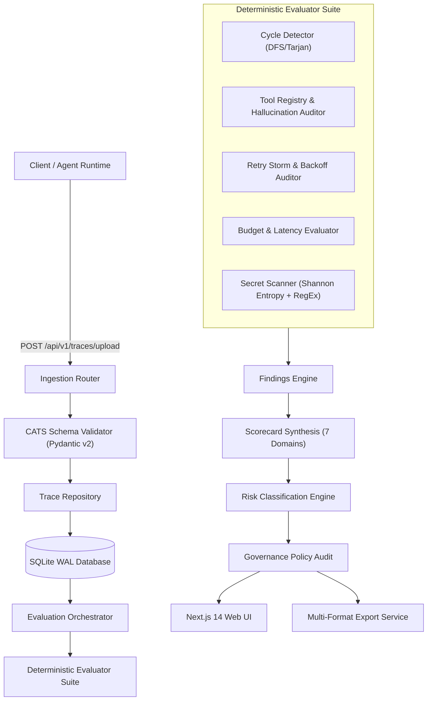

# System Architecture — Agent Evaluation Platform (AEP)

**Document Version**: 1.0.0  
**Target Release**: General Availability (v1.0.0)  
**Status**: APPROVED

---

## 1. Architectural Philosophy & Core Tenets

The Agent Evaluation Platform is designed as a specialized evaluation engine and system of record for autonomous AI agent executions. Its architectural decisions adhere to three non-negotiable principles:

1. **Evaluation Owns the Data Model**: Third-party evaluation frameworks (DeepEval, Ragas) are treated as modular, pluggable adapters, rather than foundational data schemas.
2. **Determinism First**: Graph cycles, tool hallucinations, parameter schema errors, token expenditures, and secret exposures are audited mathematically through static deterministic code without non-deterministic LLM calls.
3. **Defense in Depth**: Risk classification enforces strict safety gates—any critical security defect (e.g. exposed credentials or unhandled infinite loop) immediately clamps the risk rating to `CRITICAL` regardless of domain score averages.

---

## 2. High-Level System Architecture



---

## 3. Data Ingestion & CATS Normalization

All agent executions are ingested conforming to the **Canonical Agent Trace Schema (CATS)**:

```
CanonicalTrace
├── Session
│   ├── session_id (UUID)
│   ├── user_intent (string)
│   ├── budget_constraints (max_usd, max_latency_ms, max_tokens)
│   └── context_data (key-value metadata)
├── Agents[]
│   ├── agent_id (UUID)
│   ├── name & role
│   ├── system_prompt_hash
│   └── tool_registry[]
├── Workflow
│   ├── workflow_id (UUID)
│   ├── workflow_name
│   └── status (SUCCESS, FAILED, TIMED_OUT)
└── Steps[]
    ├── step_id (UUID)
    ├── agent_id & step_index
    ├── inputs & outputs
    ├── tool_calls[]
    │   ├── tool_call_id
    │   ├── tool_name & arguments
    │   └── result, error, latency_ms
    └── retries[]
        ├── retry_index & reason
        └── backoff_ms
```

---

## 4. Deterministic Evaluation Engine

The engine executes 5 static evaluators sequentially without external API calls:

1. **Cycle Detector (`CycleDetector`)**: Constructs a directed adjacency graph of step transitions and identifies cycles using Depth-First Search. Detects repeated invocation chains (e.g. `StepA -> StepB -> StepA`) and tags findings with severity `HIGH` or `CRITICAL`.
2. **Tool Redundancy & Registry Auditor (`ToolRegistryEvaluator`)**: Validates every invoked tool against the declared agent tool registry. Flags un-registered tool calls (`TOOL_HALLUCINATION`) and duplicate executions producing identical outputs (`TOOL_REDUNDANCY`).
3. **Retry Storm Evaluator (`RetryEvaluator`)**: Analyzes step retry sequences and backoff intervals. Flags retry counts exceeding safety thresholds (`RETRY_STORM`) and lack of exponential backoff.
4. **Budget & Latency Evaluator (`BudgetEvaluator`)**: Calculates total aggregated token usage, execution latency, and USD cost against constraints defined in the session.
5. **Secret Scanner (`SecretScanner`)**: Scans prompt inputs, model outputs, and tool payloads for API keys, passwords, bearer tokens, and high-entropy strings using Shannon entropy analysis.

---

## 5. Multi-Domain Scoring & Risk Classification

Scores are computed across 7 orthogonal domains normalized from 0.0 to 100.0:

| Domain | Weight | Primary Failure Drivers |
| :--- | :--- | :--- |
| **Task Quality** | 20% | Unfinished goals, schema errors, workflow termination failures |
| **Tool Usage** | 15% | Tool hallucinations, argument errors, duplicate calls |
| **Workflow Quality** | 15% | Step cycles, orphaned nodes, out-of-order executions |
| **Reliability** | 15% | Cascading retries, missing backoff, timeouts |
| **Safety** | 15% | Secret leaks, prompt injection vulnerabilities |
| **Cost** | 10% | Budget constraints exceeded, token overuse |
| **Efficiency** | 10% | Execution latency, step bloat |

### Risk Tiers
- **EXCELLENT**: Overall score ≥ 90.0, 0 High/Critical findings.
- **GOOD**: Overall score ≥ 75.0, 0 Critical findings.
- **WATCH**: Overall score ≥ 60.0, ≤ 1 High finding.
- **POOR**: Overall score < 60.0 or multiple High findings.
- **CRITICAL**: Any Critical safety finding or overall score < 40.0.

---

## 6. Automated Governance & Workspaces Architecture

### Policy Profiles
Policy profiles allow engineering teams to define release gating criteria:
- Minimum overall score floor (e.g., 80.0 pts)
- Domain-specific floors (e.g., Safety ≥ 90.0 pts)
- Disallowed risk tiers (e.g., `["CRITICAL", "POOR"]`)
- Prohibited finding codes (e.g., `["SECRET_EXPOSURE", "CYCLE_DETECTED"]`)
- Maximum allowable defect counts

### Multi-Tenant Isolation
Workspaces isolate evaluation data and governance profiles:
- **Multi-Tenancy**: Traces, evaluations, policies, and audit logs are scoped by `workspace_id`.
- **Role-Based Access Control (RBAC)**:
  - `ADMIN`: Full management of policies, members, and deletion.
  - `ENGINEER`: Ingest traces, run evaluations, audit candidate runs.
  - `VIEWER`: Read-only access to leaderboards, charts, and scorecards.
- **Audit Trails**: Every administrative and governance event creates an append-only, immutable record with timestamp and actor attribution.

---

## 7. Frontend Presentation Architecture

The user interface is built on Next.js 14 App Router:
- **Design System Tokens**: Light theme based on `#F8FAFC` canvas, `#FFFFFF` cards, `#E2E8F0` borders, and high-contrast `#0F172A` typography.
- **Interactive DAG Canvas**: Utilizes `@xyflow/react` (React Flow) to render step execution topologies with directional edge routing and node inspection drawers.
- **Data Visualizations**: Built with SVG and Recharts for 30-day score trajectories, daily evaluation volume, and defect frequency histograms.
- **Accessibility**: 100% compliant with WCAG 2.1 AAA contrast ratios for primary reading surfaces.

