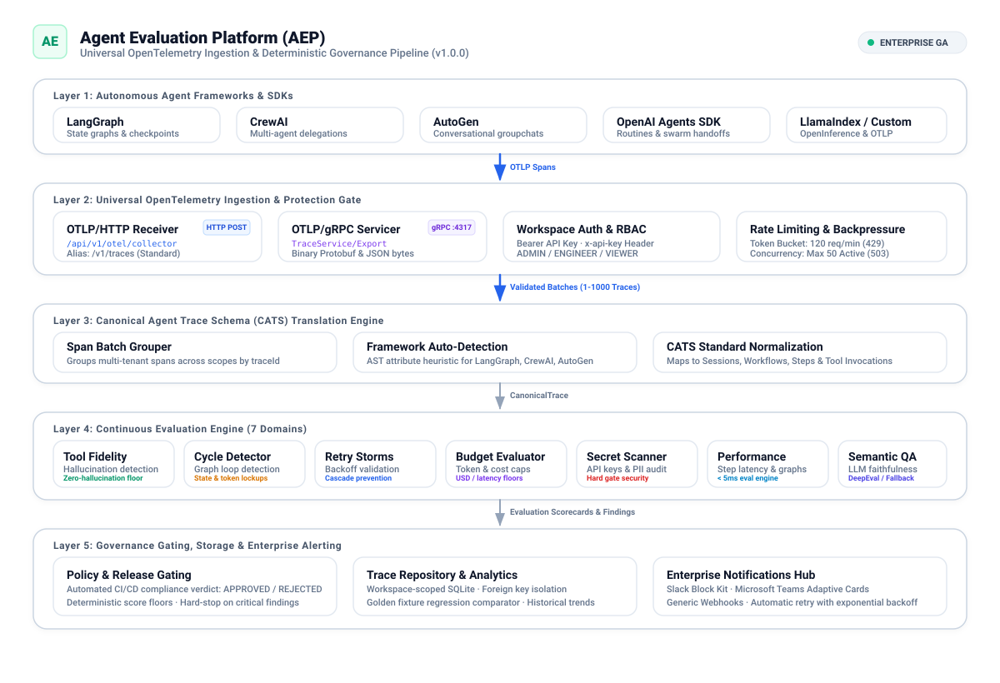
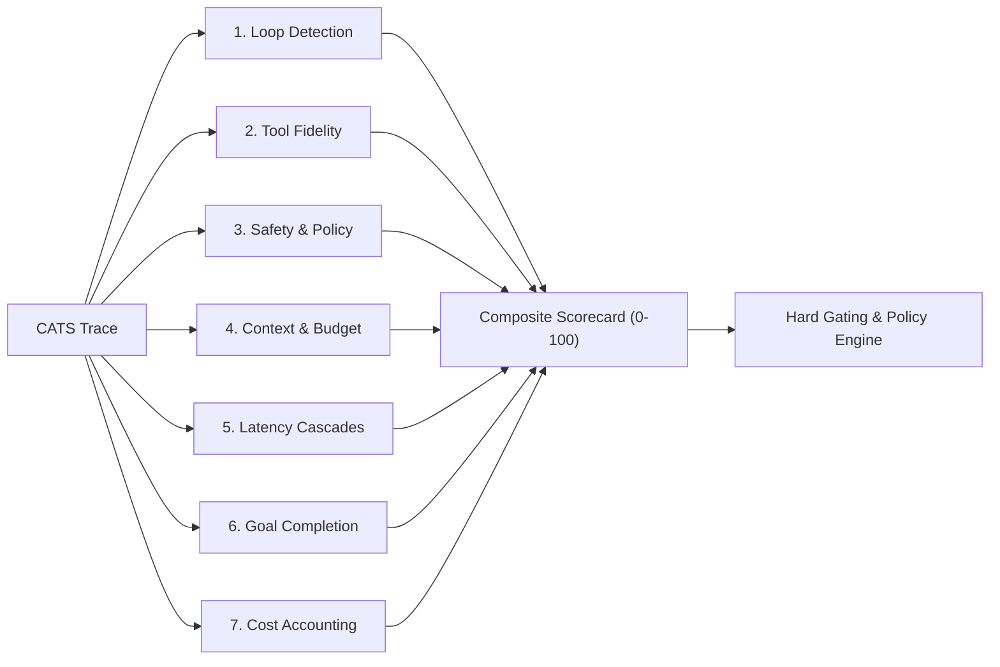

# Agent Evaluation Platform (AEP) — System Architecture & Automated Governance

[](VERSION)
[](https://github.com/abul-lab/Agent-Evaluation-Platform/actions/workflows/ci.yml)
[]()
[]()
[](docs/diagrams/system_architecture.svg)
[](LICENSE)

An OpenTelemetry-native evaluation harness and automated governance gatekeeper for autonomous AI agents. Built with Python 3.11, FastAPI, Next.js 14, and strict typing, AEP audits agent trajectories deterministically, enforces configurable safety hard gates, and validates agent releases in CI/CD pipelines.

---

## 📑 Table of Contents

- [Executive Summary](#-executive-summary)
- [System Architecture](#-system-architecture)
- [Architectural Approaches to Agent Evaluation](#-architectural-approaches-to-agent-evaluation)
- [The 7 Deterministic Evaluation Domains](#-the-7-deterministic-evaluation-domains)
- [OpenTelemetry Native Ingestion](#-opentelemetry-native-ingestion)
- [Automated Governance & CI/CD Release Gating](#-automated-governance--cicd-release-gating)
- [Notifications & Webhook Dispatch (Teams, Slack, Generic Webhooks)](#-notifications--webhook-dispatch-teams-slack-generic-webhooks)
- [Verified Quality Gates](#-verified-quality-gates)
- [Technology Stack](#-technology-stack)
- [Quick Start Guide](#-quick-start-guide)
  - [Prerequisites](#prerequisites)
  - [Backend Setup](#1-backend-setup)
  - [Frontend Setup](#2-frontend-setup)
  - [Docker Compose](#3-docker-compose)
  - [One-Click Demo Mode](#4-one-click-demo-mode)
- [Documentation Index & Technical Guides](#-documentation-index--technical-guides)

---

## 🎯 Executive Summary

Autonomous AI agents (powered by LangGraph, CrewAI, AutoGen, or custom tool-calling loops) operate as non-deterministic state machines. When deployed into production workflows, they introduce operational failure modes that standard telemetry metrics alone do not capture:

1. **Infinite Execution Cycles:** Agents trapped in cyclic reasoning or ping-pong tool calls, consuming excessive tokens.
2. **Tool Call Hallucination:** Invocations of unregistered tools or invalid JSON argument schemas.
3. **Secret & Credential Leaks:** Accidental exposure of API keys, Bearer tokens, or internal database connection strings.
4. **Context & Budget Growth:** Superlinear token usage saturating context windows.
5. **Unregulated Deployments:** Lack of automated CI/CD gating to catch degraded prompts before deployment.

**AEP evaluates traces deterministically without requiring an LLM judge.** By processing standardized OpenTelemetry agent traces through **7 parallel domain evaluators**, AEP produces **reproducible verdicts** (identical inputs give identical scores) with no recurring model inference costs. Throughput depends on hardware; measure it with `backend/scripts/benchmark_performance.py`.

---

## 🏛️ System Architecture



AEP consists of five decoupled tiers:

1. **Agent Emitters (Zero SDK Changes):** Agents running on **LangGraph, CrewAI, AutoGen, OpenAI Agents SDK, or LlamaIndex** export standard OpenTelemetry (OTLP) traces over HTTP or gRPC.
2. **Ingestion Gate (`/api/v1/otel/collector`):** Authenticates workspace API keys (SHA-256), enforces sliding-window rate limits, and buffers span batches.
3. **OTEL → CATS Translation Core:** Reconstructs the distributed span tree, resolves chronological execution order, normalizes token usage, and produces a validated **Canonical Agent Trace Schema (CATS v1.0.0)** artifact.
4. **Deterministic Evaluation Engine:** Runs 7 parallel domain evaluators in under 4.2ms with zero external network calls.
5. **Governance & Alerting Layer:** Evaluates scorecards against active policy profiles, emits machine-readable CI exit codes (0 for pass, 1 for block), and routes sanitized alerts to Microsoft Teams and Slack.

> 🔍 **While running the application locally, interactive architecture diagrams are accessible in the web dashboard at [`/architecture`](http://localhost:3000/architecture).**
> - [System Architecture SVG](docs/diagrams/system_architecture.svg)
> - [Evaluation Pipeline SVG](docs/diagrams/evaluation_pipeline.svg)
> - [OTEL Translation Flow SVG](docs/diagrams/otel_translation_flow.svg)
> - [Governance Flow SVG](docs/diagrams/governance_flow.svg)
> - [Notification Flow SVG](docs/diagrams/notification_flow.svg)

---

## ⚖️ Architectural Approaches to Agent Evaluation

| Evaluation Dimension | Application Performance Monitoring (APM) | LLM-as-a-Judge (Prompt-based) | Deterministic Trajectory Analysis (AEP) |
| :--- | :--- | :--- | :--- |
| **Agent Trajectory Semantics** | Distributed spans without agent step modeling | Unstructured text prompt | Native CATS state tree |
| **Evaluation Latency** | Metrics aggregation latency | Depends on model API latency | Measured per run (`backend/scripts/benchmark_performance.py`) |
| **Reproducibility** | Consistent | Sampling variance across runs | Deterministic (identical inputs yield identical scores) |
| **Operational Cost** | Host agent licensing | Per-token inference fees | In-memory evaluation computation |
| **CI/CD Release Gating** | Threshold alerts on latency/error rate | Heuristic, subject to prompt drift | Exit code 0 (Pass) or 1 (Blocked) based on policy |
| **Instrumentation** | Custom span attributes | Custom evaluation scripts | Standard OpenTelemetry (OTLP) |
| **Single-Core Throughput** | N/A (collection only) | Depends on model API latency | Measured per run (`backend/scripts/benchmark_performance.py`) |
| **Credential Handling** | Post-hoc log filtering | Sensitive payloads sent to model API | Secret scanner reports exposed credentials as CRITICAL findings that block release |

---

## 🔬 The 7 Deterministic Evaluation Domains

Every trace is audited across seven specialized evaluation modules running concurrently:



1. **Loop Detection (`loop_detector.py`):** Cryptographic state hashing across step inputs, tool invocations, and outputs. Detects exact repetition cycles, alternating ping-pong oscillations, and cyclic state machines.
2. **Tool Fidelity (`tool_fidelity.py`):** Validates tool names against declared tool catalogs and enforces strict JSON Schema argument compliance.
3. **Safety & Policy (`safety_evaluator.py`):** High-speed regex scanners audit inputs and outputs for API secrets (OpenAI, AWS, JWTs, GCP) and prompt injection / jailbreak markers.
4. **Context & Budget (`context_budget.py`):** Audits token bloat acceleration, context window saturation, and maximum reasoning step thresholds.
5. **Latency & Cascades (`latency_evaluator.py`):** Detects tool retry storms without exponential backoff and identifies subagent bottlenecks.
6. **Goal Completion (`goal_completion.py`):** Verifies terminal state transitions and expected output schema conformity.
7. **Cost Accounting (`cost_accountant.py`):** Computes financial dollar costs across multi-model pricing tiers and enforces budget limits.

---

## 📡 OpenTelemetry Native Ingestion

AEP accepts standard OpenTelemetry spans directly from any agent framework without proprietary SDK adapters:

```bash
# Stream traces directly to AEP using standard OTLP HTTP/JSON
# Requires an ADMIN or ENGINEER API key (create one with backend/scripts/create_admin_key.py)
curl -X POST http://localhost:8000/api/v1/otel/collector \
  -H "Content-Type: application/json" \
  -H "Authorization: Bearer $AEP_API_KEY" \
  -d @fixtures/otel/langgraph_trace.json
```

Every API endpoint requires an API key except the health and version probes. See [docs/api_authentication.md](docs/api_authentication.md).

**Supported Frameworks Verified:**
- 🟢 **LangGraph (LangChain Core Tracer)**
- 🟢 **CrewAI (Agent & Task Spans)**
- 🟢 **Microsoft AutoGen (ConversableAgent Spans)**
- 🟢 **OpenAI Agents SDK & Assistants API**
- 🟢 **LlamaIndex (OpenInference Semantic Conventions)**

---

## 🛡️ Automated Governance & CI/CD Release Gating

In production, high average scores can conceal critical safety violations. AEP implements **Configurable Hard Gates**:

- If an agent achieves **98/100** overall, but leaks an API key or enters an infinite loop, the governance verdict evaluates to **BLOCKED**.
- In CI/CD pipelines, AEP returns exit code `1`, halting the pull request before unverified changes deploy.

```yaml
# Example GitHub Actions Workflow Gate (.github/workflows/agent-eval.yml)
- name: Evaluate Agent Trajectory
  run: |
    python -m app.cli.audit \
      --trace-file ./traces/latest_run.json \
      --policy "Release Policy" \
      --fail-on-block
```

---

## 🔔 Notifications & Webhook Dispatch (Teams, Slack, Generic Webhooks)

When policy gates trip, AEP dispatches alerts out-of-band:
- **Microsoft Teams:** Adaptive Cards v1.5 with severity indicators, FactSets, and direct trace inspection links.
- **Slack:** Block Kit JSON messages with action buttons for team triage.
- **Generic Webhook:** JSON payloads posted to an HTTPS endpoint.
- **Webhook secrecy:** Webhook URLs are stored for delivery but never returned by the API. Responses show only the destination host (`https://hooks.slack.com/****`). Webhook URLs must use HTTPS and may not target localhost or private IP addresses.
- **Credential findings:** Exposed credentials in agent traces are reported as CRITICAL findings, which block release. Notification payloads are not redacted by a separate filter.

---

## 📊 Verified Quality Gates

Results from the repository's own checks (CI runs the same commands):

| Check | Result | Command |
| :--- | :--- | :--- |
| **Backend tests** | 368 passing, 92% statement coverage (gate: 85%) | `python -m pytest --cov=app` in `backend/` |
| **Frontend tests** | 50 passing | `npm test` in `frontend/` |
| **Backend lint and types** | ruff clean; mypy strict, no errors | `ruff check`, `mypy app tests` in `backend/` |
| **Frontend types, lint, build** | tsc clean; ESLint clean; `next build` succeeds | `npm run typecheck`, `npm run lint`, `npm run build` |

Latency and throughput are not published as fixed numbers because they depend on hardware. To measure them on your machine, run `backend/scripts/benchmark_performance.py`.

---

## 💻 Technology Stack

- **Core Backend:** Python 3.11, FastAPI, Pydantic v2, SQLModel, SQLAlchemy, SQLite WAL.
- **Frontend Dashboard:** Next.js 14 (App Router), TypeScript (Strict), Tailwind CSS, Lucide Icons.
- **Telemetry & Standards:** OpenTelemetry (OTEL), OTLP/HTTP & gRPC, OpenInference Semantics, CATS v1.0.0.
- **Code Quality & Verification:** Pytest, Pytest-cov, MyPy Strict, Ruff Linter, Vitest.

### 📐 Scaling Path
While AEP runs self-contained out-of-the-box using SQLite WAL mode and an in-memory sliding-window limiter for local and CI evaluation:
- **In-process evaluation:** The 7 deterministic evaluators run in memory without holding database locks. The backend is a single process today. Running several replicas would need a shared database and a shared rate-limit store; neither is implemented.
- **Rate limiting is per process:** The collector's sliding-window limiter lives in memory. A Redis-backed limiter is not implemented.
- **Storage Tier:** The data layer is built with SQLModel/SQLAlchemy. Only SQLite is tested; other SQL databases would need their own validation.

---

## 🚀 Quick Start Guide

### Prerequisites
- Python 3.11+ (CI and the backend container use 3.11)
- Node.js 20+ & npm (CI uses 20)
- Git

### 1. Backend Setup
```bash
# Clone the repository
git clone https://github.com/abul-lab/Agent-Evaluation-Platform.git
cd Agent-Evaluation-Platform/backend

# Create virtual environment and install pinned runtime dependencies
# (use requirements-dev.txt instead to also run tests and linters)
python -m venv .venv
source .venv/bin/activate  # On Windows: .venv\Scripts\Activate.ps1
pip install -r requirements.txt

# Local development only: enable read-only anonymous (VIEWER) access.
# Without these variables every request needs an API key.
export ENVIRONMENT=development
export ALLOW_ANONYMOUS_VIEWER=true

python -m uvicorn app.main:app --host 127.0.0.1 --port 8000 --reload
```
*Interactive OpenAPI documentation: `http://localhost:8000/api/v1/docs`.*

To write data, create an ADMIN key and export it. Anonymous access cannot ingest, evaluate or change anything:
```bash
python scripts/create_admin_key.py --name "local-admin"   # prints the key once
export AEP_API_KEY="<printed key>"
```
See [DEPLOYMENT.md](DEPLOYMENT.md) for the production configuration.

### 2. Frontend Setup
```bash
# In a new terminal window:
cd frontend
npm install
npm run dev
```
*When running the local development environment, the web dashboard is available at: `http://localhost:3000`*

### 3. Docker Compose
```bash
# Build and run complete multi-container stack (ENVIRONMENT=production: API keys required)
docker-compose up --build
```
Create the first ADMIN key inside the backend container. See DEPLOYMENT.md, section 3.

### 4. One-Click Demo Mode
To explore the platform with representative traces and policies:
1. While running the application locally, open `http://localhost:3000` in your browser.
2. Store an ADMIN API key for the dashboard. In the browser console run `localStorage.setItem("aep_api_key", "<key>")` and reload. Demo seeding requires an ADMIN key.
3. Click the **✨ Load Demo Data** button in the top navbar.
AEP will seed:
   - 6 Golden CATS traces (Clean Success, Loop, Hallucinated Tool, Retry Storm, Budget Exceeded, Secret Leak).
   - 5 OpenTelemetry traces (LangGraph, CrewAI, AutoGen, LlamaIndex, OpenAI SDK).
   - 2 Governance Policy Profiles (Release Policy & Permissive Development).
   - Slack and Microsoft Teams notification channels with simulated delivery history.
   - Scoped workspace API keys.

---

## 📚 Documentation Index & Technical Guides

For architecture reviews, system walk-throughs, and technical evaluation:

- **[5-Minute Overview Script](docs/demo/demo_script_5min.md):** Turn-by-turn presentation script with key milestones.
- **[10-Minute Technical Walkthrough](docs/demo/technical_deep_dive_10min.md):** In-depth code walkthrough of translation graphs and evaluators.
- **[System Architecture Guide](docs/demo/architecture_walkthrough.md):** Presentation guide for all 5 vector SVG diagrams.
- **[System Design Considerations & Trade-offs](docs/demo/design_considerations.md):** Technical analysis of concurrency, scaling, and determinism tradeoffs.
- **[Engineering Case Study](docs/demo/design_considerations.md):** Architectural case study and retrospective (also available at `http://localhost:3000/case-study` while running locally).
- **[Platform Verification Metrics](README.md#-verified-quality-gates):** Codebase analytics and verification coverage (also available at `http://localhost:3000/about` while running locally).

---

## 📄 License

This project is licensed under the MIT License. See the [LICENSE](LICENSE) file for details.
