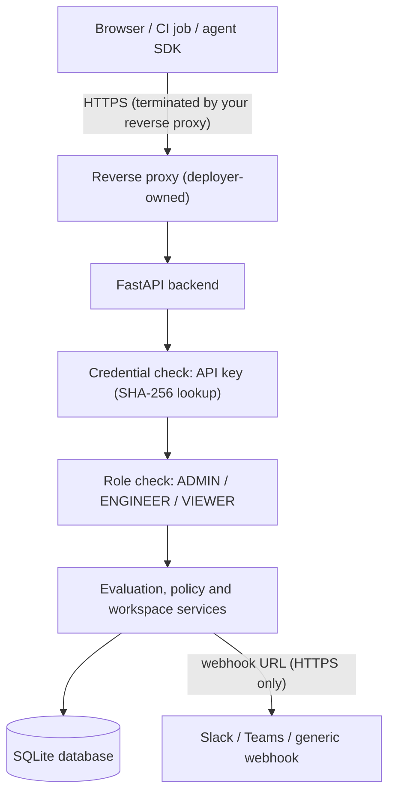

# Security Policy — Agent Evaluation Platform (AEP)

**Version**: 1.0.0  
**Scope**: The backend API (`backend/`), the dashboard (`frontend/`), and the container and deployment files.

This document describes how security is enforced in the code today, what the deployer must provide, and what is not yet covered. For the deployment checklist see [DEPLOYMENT.md](DEPLOYMENT.md). For the endpoint-by-endpoint permission matrix see [docs/api_authentication.md](docs/api_authentication.md).

---

## 1. Trust Boundaries

- **Transport (TLS)** is not implemented inside the application. The deployer must terminate TLS at a reverse proxy (see DEPLOYMENT.md, section 4).
- **Identity** is an API key. There is no user login, SSO, or per-user accounts.
- **Tenancy**: each API key is bound to one workspace. Queries are filtered by workspace.

---

## 2. Authentication

| Rule | Enforcement |
|---|---|
| Every API call except the health and version probes requires a credential. | `backend/app/auth/dependencies.py` (`resolve_principal`) and the read floor applied in `backend/app/api/v1/router.py`. |
| A credential is `Authorization: Bearer aep_<40 hex>`, or `x-api-key` on OTLP ingestion. | Keys are matched by SHA-256 digest. Plaintext is never stored. |
| Invalid, expired, or revoked keys return HTTP 401. | `authenticate_key` in `backend/app/services/auth_service.py`. |
| Anonymous callers never receive ADMIN or ENGINEER rights. | The anonymous identity is VIEWER only, and mutating routes reject anonymous callers in every environment. |
| Anonymous read access exists only when `ENVIRONMENT=development` **and** `ALLOW_ANONYMOUS_VIEWER=true`. | `Settings.anonymous_access_enabled` in `backend/app/core/config.py`. |
| The default environment is `production` (fail closed). | `backend/app/core/config.py`. |
| The first ADMIN key is created on the server, not over the network. | `backend/scripts/create_admin_key.py`. |

---

## 3. Authorization (RBAC)

| Role | Permitted actions |
|---|---|
| `VIEWER` | Read traces, evaluations, scorecards, findings, benchmarks, analytics, policies, workspace data, and notification history. |
| `ENGINEER` | Everything `VIEWER` can do, plus ingest traces (REST and OTLP), run evaluations, run benchmark comparisons, regression checks and policy audits, and list API keys. |
| `ADMIN` | Everything `ENGINEER` can do, plus create, revoke, and list API keys, create and modify workspaces and members, create, update, and delete governance policies, manage notification channels, and seed demo data. |

Every `POST`, `PUT`, `PATCH`, and `DELETE` route requires an authenticated identity and a role. The read floor applies to every router. Enforcement is covered by `backend/tests/auth/test_security_hardening.py`, which asserts 401 for anonymous callers on every mutating route and 403 for insufficient roles.

**Known gap:** role checks rely on each route declaring its dependency. A new mutating route that omits one would be unprotected, and the test suite only covers routes listed in it. Add new routes to that test.

---

## 4. Webhook and Notification Protection

- **Storage**: webhook URLs are stored as given, because they are needed to deliver alerts. They are **not encrypted at rest**. Anyone with database access can read them.
- **Responses**: the API never returns a raw webhook URL. Channel responses contain `webhook_url_masked` (`https://hooks.slack.com/****`). Delivery errors have the raw URL replaced before they are stored or returned.
- **Destination validation** (`backend/app/core/webhook_security.py`): HTTPS only; no embedded credentials; no `localhost`; no private, loopback, link-local, reserved, or multicast IP literals.
- **Delivery-time DNS check** (`assert_resolves_publicly`): before each send, the host is resolved, and delivery is refused if any address is private, loopback, link-local, or reserved. DNS rebinding between that check and the connection is not fully prevented. Egress filtering at the network layer is still required if the server can reach internal networks.

---

## 5. CORS

- Wildcard origins (`*`) are rejected at startup.
- `CORS_ALLOWED_ORIGINS` is a comma-separated allowlist. In `development` and `test` it defaults to `http://localhost:3000,http://127.0.0.1:3000`.
- In any other environment the variable is required. The application refuses to start without it.
- Allowed methods are `GET, POST, PUT, DELETE, OPTIONS`. Allowed headers are `Authorization, Content-Type, X-API-Key`.

---

## 6. Secrets Handling

- **Client credentials**: API keys are hashed (SHA-256) and shown once at creation. Revocation takes effect immediately. The API has no key rotation workflow; rotate by creating a new key and revoking the old one.
- **Frontend**: the dashboard reads an optional key from `localStorage` (`aep_api_key`). Anyone who can run script in the dashboard origin can read that key. Do not place keys in `NEXT_PUBLIC_*` variables, because they are shipped to every visitor.
- **Ingested traces**: the deterministic secret scanner (`backend/app/evaluators/secret_scanner.py`) detects common credential formats (AWS keys, OpenAI-style keys, GitHub tokens, private keys, Slack tokens, bearer tokens) and high-entropy strings in tool inputs and outputs. Detection is heuristic. It does not guarantee that no secret is missed.
- **Repository hygiene**: `.env`, `*.db`, caches, and `node_modules` are excluded from git (`.gitignore`) and from container images (`backend/.dockerignore`, `frontend/.dockerignore`). The example AWS keys in `fixtures/` and `docs/` are the AWS documentation example values, used as test data.

---

## 7. Audit Logging

- Administrative events (key create, use, and revoke; workspace and member changes; policy changes) are written to `workspace_audit_logs` with actor, action, resource, and timestamp.
- **No API endpoint updates or deletes individual audit records.** Deleting a workspace (ADMIN only) also deletes its audit logs. Treat the database as the system of record for retention, and back it up.
- Rejected API-key attempts are returned as HTTP 401 and logged to the application log with only the first 8 characters of the key and its length. They are **not** written to the workspace audit log.

---

## 8. Input Handling and Output Safety

- Request bodies are validated with Pydantic v2 models. Several request models (notably the notification schemas) forbid unknown fields; this is not yet applied uniformly.
- Database access uses SQLModel/SQLAlchemy parameterized queries.
- OTLP payloads are validated and capped at 15 MB by default (`backend/app/otel/collector_validation.py`).
- **Not implemented:** CSV exports do not neutralize spreadsheet formula characters (`=`, `+`, `-`, `@`). Opening an exported CSV in a spreadsheet can execute attacker-controlled formulas. See R13 in section 11.

---

## 9. Rate Limiting and Availability

- The OTLP collector has an **in-process** per-workspace rate limiter and backpressure monitor. These limits are per process, reset on restart, and do not apply across multiple replicas.
- SQLite supports one writer at a time. The platform is designed for a single backend instance.
- Put request rate limits and connection limits at the reverse proxy. The platform does not limit login or key-guessing attempts itself. Guessing a 160-bit key is not practical, but the proxy should still limit abusive traffic.

---

## 10. Container and Build Security

- The backend image runs as an unprivileged `app` user. The frontend image runs as `node`.
- Python dependencies are pinned in `backend/requirements.txt` (runtime) and `backend/requirements-dev.txt` (tests and linters) with exact versions. Frontend dependencies are pinned by `frontend/package-lock.json`.
- **In CI:** `pip-audit` runs against the pinned Python runtime dependencies, and `npm audit --audit-level=high` runs against the frontend. CodeQL and Dependabot run on the repository.
- **Not in CI yet:** container image scanning. Add these before relying on the project in production.

---

## 11. Remaining Risks (Known and Accepted for v1.0.0)

| # | Risk | Mitigation today | Recommended action |
|---|---|---|---|
| R1 | No user accounts or SSO. Every human uses a shared or personal API key. | Keys are workspace-scoped and revocable. | Add an identity provider in front of the dashboard, or a server-side session proxy. |
| R2 | The dashboard stores its API key in `localStorage`. | Only an optional, per-browser key. | Use a server-side proxy that keeps the key out of the browser. |
| R3 | Webhook URLs are stored unencrypted. | Not returned by the API. | Encrypt the database volume, or add field-level encryption. |
| R4 | DNS-based SSRF through webhook hostnames. | Literal private IPs and `localhost` are rejected at save time. Hostnames that resolve to private addresses are refused at delivery. | Enforce egress filtering on the backend host. DNS rebinding is not fully prevented. |
| R5 | No built-in TLS. | Documented reverse-proxy setup. | Deploy behind TLS only. |
| R6 | Rate limits are per process only. | Documented proxy limits. | Enforce limits at the proxy. |
| R7 | Audit logs are deleted with their workspace. | Documented; ADMIN-only. | Export audit logs to external storage if they must be retained. |
| R8 | Failed authentication attempts are not in the workspace audit log. | Rejected keys are logged to the application log (key prefix and length only). | Ship application logs to central storage, or log at the reverse proxy. |
| R9 | `/system/info` and `/version` are public. They expose version, module names, and database status. | No secrets are exposed. | Restrict at the proxy if the deployment should not reveal its version. |
| R10 | A key's role is fixed at creation. There are no scopes narrower than the three roles. | Least privilege by role choice. | Issue ENGINEER keys to CI, not ADMIN keys. |
| R11 | `created_by` on key creation is caller-supplied (audit metadata only). | Actor on the audit trail is the authenticated principal. | Treat `created_by` as informational. |
| R12 | No container image scanning. | `pip-audit` and `npm audit` run in CI; CodeQL and Dependabot are enabled. | Add container image scanning if the images are ever deployed. |
| R13 | Resolved. Spreadsheet formula characters at the start of CSV cells are prefixed with a single quote (`csv_safe` in `report_service.py`). | Tested in `backend/tests/services/test_csv_safety.py`. | n/a |
| R14 | Resolved. Documentation previously described HMAC-signed webhooks, which the code does not implement; the docs now describe the actual behavior. | n/a | Re-add signing as a feature if needed. |

---

## 12. Vulnerability Reporting

Please do not open public GitHub issues for security vulnerabilities.

Report privately through GitHub's security advisory form: <https://github.com/abul-lab/Agent-Evaluation-Platform/security/advisories/new>. This is the only supported channel.

Response targets (best effort for a community project): acknowledgement within 72 hours, and a fix or mitigation plan for high and critical issues as soon as practical.
