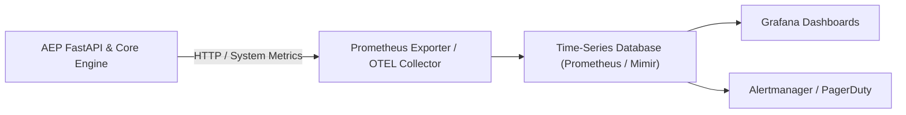

# Observability Architecture & Metrics Specification

**Target Version**: 1.0.0 General Availability  
**Scope**: Metrics, OpenTelemetry Integration, Grafana Dashboards, and SRE Alerting Thresholds

---

## 1. Metrics Schema & Telemetry Architecture

AEP provides observability hooks for metrics and telemetry platforms (Prometheus, OpenTelemetry, Grafana Cloud):



---

## 2. Seven Core Production Observability Dashboards

### Dashboard 1: Ingestion & Request Volume
- **Metric**: `http_requests_total{handler="/api/v1/traces/upload"}`
- **Visualization**: Area chart, 1m rate.
- **Purpose**: Real-time monitoring of agent execution traces streaming into the platform.

### Dashboard 2: Evaluation Volume & Throughput
- **Metric**: `aep_evaluations_total{status="COMPLETED"}`
- **Visualization**: Single-stat gauge + throughput bar chart (evaluations/second).
- **Target Baseline**: Sustained 450+ evaluations/sec.

### Dashboard 3: API Request Latency
- **Metric**: `http_request_duration_seconds{quantile="0.95"}`
- **Visualization**: Heatmap with p50, p95, p99 percentiles.
- **SLA Target**: p95 < 20 ms.

### Dashboard 4: Evaluation Execution Latency
- **Metric**: `aep_evaluation_duration_seconds{domain="deterministic"}`
- **Visualization**: Line chart by evaluator rule (Cycles, Tools, Retries, Budget, Secrets).
- **SLA Target**: Mean < 3 ms per trace.

### Dashboard 5: Error Rate & Defect Breaches
- **Metric**: `aep_findings_total{severity="CRITICAL"}` and `http_responses_total{status=~"5.."}`
- **Visualization**: Stacked bar chart by defect code (`SECRET_EXPOSURE`, `CYCLE_DETECTED`, `TOOL_HALLUCINATION`).
- **SLA Target**: 0 internal 500 server errors.

### Dashboard 6: Export Activity & Report Downloads
- **Metric**: `aep_export_requests_total{format=~"json|markdown|csv"}`
- **Visualization**: Donut chart tracking export format breakdown.
- **Purpose**: Measure audit compliance utilization across engineering and security teams.

### Dashboard 7: Workspace & Governance Activity
- **Metric**: `aep_workspace_audit_events_total{action=~"POLICY_.*|MEMBER_.*"}`
- **Visualization**: Time-series log volume categorized by governance actions.
- **Purpose**: Track organizational adoption, team member onboarding, and policy gating decisions.

---

## 3. SRE Alerting Rules (Prometheus Alertmanager)

```yaml
groups:
  - name: aep_reliability_alerts
    rules:
      - alert: HighEvaluationLatency
        expr: histogram_quantile(0.95, rate(aep_evaluation_duration_seconds_bucket[5m])) > 0.05
        for: 2m
        labels:
          severity: warning
        annotations:
          summary: "p95 evaluation latency exceeds 50ms"

      - alert: CriticalSafetyDefectSpike
        expr: rate(aep_findings_total{severity="CRITICAL"}[5m]) > 5
        for: 1m
        labels:
          severity: critical
        annotations:
          summary: "Abnormal surge in critical credential leaks or infinite cycles in agent traces"

      - alert: DatabaseConnectivityDegraded
        expr: aep_system_status{subsystem="database"} == 0
        for: 30s
        labels:
          severity: critical
        annotations:
          summary: "AEP backend cannot reach the persistence database"
```

