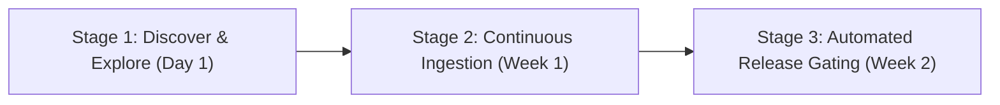

# Customer Onboarding & First-Run Experience (FRE)

**Audience**: AI/ML Platform Engineers, Engineering Leads, and Reliability Teams  
**Goal**: Guide a new team from zero to their first automated agent evaluation and governance policy audit in under 15 minutes.

---

## 1. The 3-Stage Onboarding Journey



### Stage 1: Discover & Explore (Day 1)
- **Action**: Launch Docker stack with `docker compose up -d`.
- **First-Run Moment**: Ingest sample golden traces directly from the Overview UI dashboard (when running the application locally: `http://localhost:3000`).
- **Aha! Moment**: Watch the 7-domain scorecard calculate in under 3 milliseconds with zero external LLM API cost.

### Stage 2: Continuous Ingestion (Week 1)
- **Action**: Connect existing agent runners (LangGraph, CrewAI, AutoGen, or custom) to `POST /api/v1/traces/upload`.
- **Value**: Automatic cycle detection, retry cascade monitoring, and tool hallucination detection across every test run.
- **Artifact**: Export audit reports in JSON, Markdown, or CSV directly to CI build logs.

### Stage 3: Automated Release Gating (Week 2)
- **Action**: Define an organizational policy profile in the policy dashboard (while running locally: `http://localhost:3000/policies`).
- **Integration**: Add `POST /api/v1/policies/{id}/audit/{eval_id}` to GitHub Actions / GitLab CI.
- **Enforcement**: Block automated deployment when a candidate run violates minimum score floors or leaks secrets.

---

## 2. Step-by-Step Interactive Getting Started Guide

### Step 1: Initialize Workspace
1. While running the local development environment, navigate to `http://localhost:3000/workspaces`.
2. Click **+ Create Workspace**.
3. Name your workspace (e.g. `Customer Triage Agents`).
4. Add team members with appropriate RBAC roles (`ADMIN`, `ENGINEER`, `VIEWER`).

### Step 2: Ingest First Execution Trace
You can ingest traces via the UI or CLI:
- **UI**: While running the application locally, open `http://localhost:3000/`, paste any trace JSON into the Ingestion panel, and click **Ingest & Evaluate**.
- **Python**:
  ```python
  import requests
  with open("fixtures/clean_success_trace.json") as f:
      res = requests.post("http://localhost:8000/api/v1/traces/upload", json=json.load(f))
      trace_id = res.json()["trace_id"]
  ```

### Step 3: Inspect the Interactive DAG
1. While running the application locally, click on the evaluated trace in `http://localhost:3000/traces`.
2. Click **View Execution Graph** to explore the topological DAG.
3. Click any node to open the side inspection drawer showing inputs, outputs, tool latency, and token expenditure.

### Step 4: Compare Against Baseline in Benchmarks
1. While running the application locally, open `http://localhost:3000/benchmarks`.
2. Select your baseline run (v1.0) and candidate run (v1.1-rc).
3. Review signed deltas (+15.7 pts), risk tier transition (`WATCH` -> `EXCELLENT`), and resolved defects.

