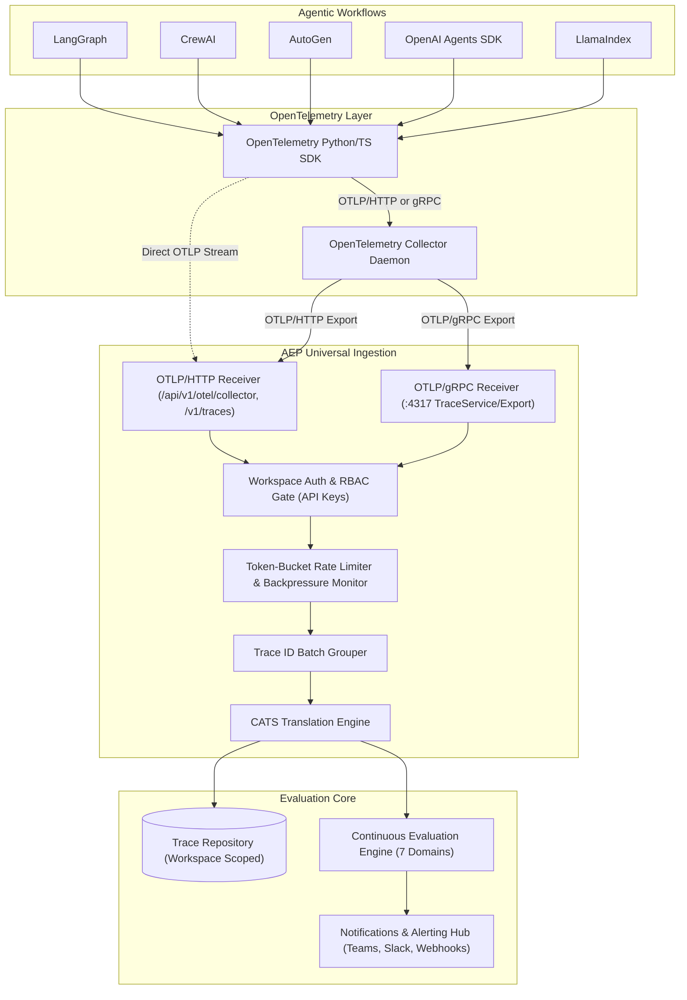

# OpenTelemetry Collector Native Receiver Guide

**Version:** `v1.0.0`  
**Platform:** Agent Evaluation Platform (AEP)  
**Status:** General Availability  

---

## 1. Architecture Overview

The OpenTelemetry Collector Native Receiver enables production OpenTelemetry Collectors, agent frameworks, and AI workflows to stream execution traces directly into AEP over standard OTLP protocols without custom ingestion scripts.

Incoming spans are ingested in batches, grouped by `traceId`, translated automatically into the **Canonical Agent Trace Schema (CATS)**, bound to the authenticated **Workspace**, and immediately audited by the deterministic evaluation engine across all 7 evaluation domains.



---

## 2. Ingestion Endpoints & Protocol Support

### 2.1 OTLP/HTTP

| Endpoint | Method | Content-Type | Description |
| :--- | :--- | :--- | :--- |
| `/api/v1/otel/collector` | `POST` | `application/json` | Primary universal OTLP/HTTP collector receiver. |
| `/v1/traces` | `POST` | `application/json` | Canonical endpoint alias expected by default OpenTelemetry `otlphttp` exporters. |

### 2.2 OTLP/gRPC

| Endpoint | Port | Service | Method |
| :--- | :--- | :--- | :--- |
| `localhost:4317` | `4317` | `opentelemetry.proto.collector.trace.v1.TraceService` | `Export` |

---

## 3. Authentication & Workspace Binding

Traces ingested through the collector are strictly isolated by workspace. Authentication is verified via workspace-scoped API keys:

1. **Bearer Token:** `Authorization: Bearer aep_live_...`
2. **Custom Header:** `x-api-key: aep_live_...`
3. **gRPC Metadata:** `authorization` or `x-api-key` key-value pairs in invocation metadata.

> [!NOTE]
> Requests without a valid key are rejected with HTTP 401. Keys with the VIEWER role are rejected with HTTP 403: only ADMIN and ENGINEER keys may ingest traces. The key's workspace determines where traces are stored. Anonymous ingestion is not supported in any environment.

---

## 4. Rate Limiting & Backpressure Protection

To protect system availability during high trace volume, the receiver incorporates protection mechanisms:

* **Token-Bucket Rate Limiter:** Evaluated per workspace at `120 requests/minute` with burst capacity of `60 tokens`. Exceeded limits return HTTP `429 Too Many Requests` with a standard `Retry-After` header (or gRPC `RESOURCE_EXHAUSTED`).
* **Concurrency Backpressure:** Limits active concurrent batch translations to `50 concurrent executions`. Overload conditions return HTTP `503 Service Unavailable` with `Retry-After`.
* **Payload & Span Ceilings:** Rejects batches exceeding `15 MB` payload size or more than `10,000 spans` per request to prevent memory exhaustion.

---

## 5. Collector Configuration (`otel-collector-config.yaml`)

Deploy an OpenTelemetry Collector with the following pipeline to stream traces into AEP:

```yaml
receivers:
  otlp:
    protocols:
      grpc:
        endpoint: 0.0.0.0:4317
      http:
        endpoint: 0.0.0.0:4318

processors:
  batch:
    timeout: 1s
    send_batch_size: 100

exporters:
  otlphttp/aep:
    endpoint: http://localhost:8000/api/v1/otel/collector
    headers:
      Authorization: "Bearer ${AEP_API_KEY}"
      # Alternative header:
      # x-api-key: "${AEP_API_KEY}"

service:
  pipelines:
    traces:
      receivers: [otlp]
      processors: [batch]
      exporters: [otlphttp/aep]
```

---

## 6. Framework SDK Direct Streaming

### 6.1 LangGraph

```python
import os
from opentelemetry import trace
from opentelemetry.exporter.otlp.proto.http.trace_exporter import OTLPSpanExporter
from opentelemetry.sdk.trace import TracerProvider
from opentelemetry.sdk.trace.export import BatchSpanProcessor
from opentelemetry.sdk.resources import Resource

# Initialize Provider
resource = Resource.create({"service.name": "langgraph-agent", "framework": "langgraph"})
provider = TracerProvider(resource=resource)
exporter = OTLPSpanExporter(
    endpoint="http://localhost:8000/api/v1/otel/collector",
    headers={"Authorization": f"Bearer {os.getenv('AEP_API_KEY')}"}
)
provider.add_span_processor(BatchSpanProcessor(exporter))
trace.set_tracer_provider(provider)

# Run LangGraph Workflow
# app = workflow.compile()
# result = app.invoke({"messages": [...]})
```

### 6.2 CrewAI

```python
import os
from opentelemetry import trace
from opentelemetry.exporter.otlp.proto.http.trace_exporter import OTLPSpanExporter
from opentelemetry.sdk.trace import TracerProvider
from opentelemetry.sdk.trace.export import BatchSpanProcessor
from opentelemetry.sdk.resources import Resource

resource = Resource.create({"service.name": "crewai-multi-agent", "framework": "crewai"})
provider = TracerProvider(resource=resource)
exporter = OTLPSpanExporter(
    endpoint="http://localhost:8000/api/v1/otel/collector",
    headers={"x-api-key": os.getenv("AEP_API_KEY")}
)
provider.add_span_processor(BatchSpanProcessor(exporter))
trace.set_tracer_provider(provider)

# Crew execution traces stream directly into AEP
# crew = Crew(agents=[analyst, writer], tasks=[research, draft])
# result = crew.kickoff()
```

### 6.3 AutoGen

```python
import os
from opentelemetry import trace
from opentelemetry.exporter.otlp.proto.http.trace_exporter import OTLPSpanExporter
from opentelemetry.sdk.trace import TracerProvider
from opentelemetry.sdk.trace.export import BatchSpanProcessor
from opentelemetry.sdk.resources import Resource

resource = Resource.create({"service.name": "autogen-groupchat", "framework": "autogen"})
provider = TracerProvider(resource=resource)
exporter = OTLPSpanExporter(
    endpoint="http://localhost:8000/api/v1/otel/collector",
    headers={"Authorization": f"Bearer {os.getenv('AEP_API_KEY')}"}
)
provider.add_span_processor(BatchSpanProcessor(exporter))
trace.set_tracer_provider(provider)
```

### 6.4 OpenAI Agents SDK

```python
import os
from opentelemetry import trace
from opentelemetry.exporter.otlp.proto.http.trace_exporter import OTLPSpanExporter
from opentelemetry.sdk.trace import TracerProvider
from opentelemetry.sdk.trace.export import BatchSpanProcessor
from opentelemetry.sdk.resources import Resource

provider = TracerProvider(
    resource=Resource.create({"service.name": "openai-swarm", "framework": "openai_agents"})
)
provider.add_span_processor(
    BatchSpanProcessor(
        OTLPSpanExporter(
            endpoint="http://localhost:8000/api/v1/otel/collector",
            headers={"Authorization": f"Bearer {os.getenv('AEP_API_KEY')}"}
        )
    )
)
trace.set_tracer_provider(provider)
```

### 6.5 LlamaIndex

```python
import os
from openinference.instrumentation.llama_index import LlamaIndexInstrumentor
from opentelemetry.exporter.otlp.proto.http.trace_exporter import OTLPSpanExporter
from opentelemetry.sdk.trace import TracerProvider
from opentelemetry.sdk.trace.export import BatchSpanProcessor

provider = TracerProvider()
provider.add_span_processor(
    BatchSpanProcessor(
        OTLPSpanExporter(
            endpoint="http://localhost:8000/api/v1/otel/collector",
            headers={"Authorization": f"Bearer {os.getenv('AEP_API_KEY')}"}
        )
    )
)
LlamaIndexInstrumentor().instrument(tracer_provider=provider)
```

### 6.6 Generic OpenTelemetry (Python)

```python
import os
from opentelemetry import trace
from opentelemetry.exporter.otlp.proto.http.trace_exporter import OTLPSpanExporter
from opentelemetry.sdk.trace import TracerProvider
from opentelemetry.sdk.trace.export import BatchSpanProcessor

provider = TracerProvider()
provider.add_span_processor(
    BatchSpanProcessor(
        OTLPSpanExporter(
            endpoint="http://localhost:8000/api/v1/otel/collector",
            headers={"Authorization": f"Bearer {os.getenv('AEP_API_KEY')}"}
        )
    )
)
trace.set_tracer_provider(provider)
tracer = trace.get_tracer("agent-core")

with tracer.start_as_current_span("agent_execution") as span:
    span.set_attribute("agent.status", "completed")
```

---

## 7. Response Schema & Partial Success Semantics

The receiver returns the standard OTLP `ExportTraceServiceResponse` JSON format enriched with AEP evaluation metadata:

```json
{
  "partialSuccess": {
    "rejectedSpans": 0,
    "errorMessage": ""
  },
  "tracesIngested": 1,
  "spansIngested": 4,
  "traceIds": [
    "b867c295-c89b-4654-8c44-b0eb8be3b1f1"
  ],
  "evaluationIds": [
    "51c6c59b-f117-4886-bce7-74299b9cfd4e"
  ],
  "workspaceId": "11111111-1111-1111-1111-111111111111"
}
```

If individual traces within a multi-trace batch contain corrupted structures, valid traces proceed to persistence and evaluation, while rejected spans are reported in `partialSuccess.rejectedSpans` and `errorMessage` without failing the entire batch.

