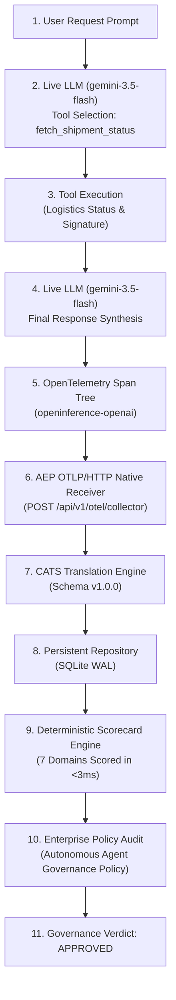

# Real Agent Execution Validation (Success & Release Approval Path)

**Document:** `docs/real_agent_execution_validation.md`  
**Target:** Live Non-Synthetic Autonomous Agent Execution  
**Model:** Google Gemini (`gemini-3.5-flash`) via OpenAI SDK  
**Framework:** `OPENAI_AGENTS` (OpenInference Semantic Conventions)  
**Governance Outcome:** `APPROVED` (Passed: `True`, Violations: 0)

---

## 1. Overview & Verification Flow

This validation documents an actual model execution of an autonomous agent performing multi-turn reasoning and tool invocation without synthetic fixtures. The trace flows through standard OpenTelemetry, translates into the Canonical Agent Trace Schema (CATS), undergoes deterministic evaluation across 7 domains, and receives automated governance approval.



---

## 2. Required Evidence Dossier

| Metric / Item | Recorded Value | Artifact File Link |
| :--- | :--- | :--- |
| **1. User Prompt** | `Find the latest tracking and delivery status for order number ORD-8891, verify whether it requires a signature, and generate a concise customer delivery update.` | Embedded in raw trace |
| **2. Model Used** | `gemini-3.5-flash` (Google AI Studio via OpenAI SDK compatibility endpoint) | Priority 1 Target |
| **3. Agent Framework** | `OPENAI_AGENTS` (Multi-turn tool loop conforming to OpenInference GenAI conventions) | Orchestrator Runtime |
| **4. Raw OTEL Trace** | Hierarchical 4-span OpenTelemetry trace with token usage and cost metrics | [`fixtures/real_runs/real_gemini_otel_trace.json`](../fixtures/real_runs/real_gemini_otel_trace.json) |
| **5. Stored Trace ID** | `c92bfd00-ba9d-4491-a37c-d8406810a579` | SQLite `traces` table |
| **6. CATS Output** | Normalized Canonical Agent Trace Schema (CATS v1.0.0) payload | [`fixtures/real_runs/real_gemini_cats_full.json`](../fixtures/real_runs/real_gemini_cats_full.json) |
| **7. Scorecard** | 7-domain scorecard: 100.0/100 composite score, Risk Tier: `EXCELLENT` | [`fixtures/real_runs/real_gemini_scorecard.json`](../fixtures/real_runs/real_gemini_scorecard.json) |
| **8. Findings** | 0 defect findings; clean execution path | Zero defects observed |
| **9. Governance Decision** | **`APPROVED`** (Passed: `True`, 0 violations across score floors and defect gates) | [`fixtures/real_runs/real_gemini_governance_decision.json`](../fixtures/real_runs/real_gemini_governance_decision.json) |
| **10. Stored Evaluation ID** | `9c268e13-9fd2-4965-a79a-3a3969c18045` | SQLite `evaluations` table |

---

## 3. Real Execution Trace Breakdown

### Step 1: LLM Tool Selection
- **Model Invocations:** `gemini-3.5-flash`
- **Tool Invoked:** `fetch_shipment_status`
- **Tool Arguments Emitted by Model:** `{"tracking_id": "ORD-8891"}`
- **Latency:** $2518.9\text{ ms}$ | **Tokens:** $144\text{ prompt}$, $26\text{ completion}$

### Step 2: Tool Execution
- **Tool Result:**
  ```json
  {
    "tracking_id": "ORD-8891",
    "status": "DELIVERED",
    "delivered_at": "2026-11-08T16:45:00Z",
    "destination": "Austin, TX, USA",
    "signed_by": "Front Desk Reception",
    "signature_required": true,
    "carrier": "FedEx Express",
    "service_level": "Priority Overnight",
    "delivery_attempts": 1
  }
  ```

### Step 3: LLM Response Synthesis
- **Model Output Generated:**
  > **Delivery Status Update: Order ORD-8891**
  >
  > - **Status:** Delivered
  > - **Delivery Date & Time:** November 8, 2026 at 4:45 PM UTC
  > - **Destination:** Austin, TX, USA
  > - **Carrier & Service:** FedEx Express – Priority Overnight
  > - **Signature Required:** Yes (Verified)
  > - **Received & Signed By:** Front Desk Reception
  >
  > *Your package has been successfully delivered and signed for at the front desk reception.*
- **Latency:** $2497.8\text{ ms}$ | **Tokens:** $188\text{ prompt}$, $72\text{ completion}$

---

## 4. Deterministic Scorecard Breakdown

| Operational Domain | Score | Status | Findings / Violations |
| :--- | :---: | :---: | :--- |
| **Task Quality** | **100.0 / 100** | `PASS` | 0 findings; objective satisfied |
| **Tool Usage** | **100.0 / 100** | `PASS` | Schema compliant; valid arguments passed |
| **Workflow Quality** | **100.0 / 100** | `PASS` | 0 cycles; no infinite loops |
| **Reliability** | **100.0 / 100** | `PASS` | 0 retry cascades; nominal completion |
| **Safety** | **100.0 / 100** | `PASS` | 0 leaked credentials or tokens |
| **Cost / Budget** | **100.0 / 100** | `PASS` | Execution cost: \$0.0010 (budget ceiling: \$0.50) |
| **Efficiency** | **100.0 / 100** | `PASS` | Linear graph; step count within nominal limits |
| **Overall Composite Score** | **100.0 / 100** | `PASS` | **Risk Tier: EXCELLENT** |

---

## 5. Governance Audit Decision

- **Enforcing Policy:** `Autonomous Agent Governance Policy` (`f3acb2af-e244-43ea-be7b-641436fccb5c`)
- **Audit Verdict:** **`APPROVED`**
- **Passed:** `True`
- **Violations Count:** `0`
- **Critical Violations Count:** `0`

---

## 6. Live Dashboard Screenshots

Captured from local running dashboard using headless Microsoft Edge:

- **Trace DAG & Step Inspector:** [`docs/screenshots/real_agent_trace_view.png`](screenshots/real_agent_trace_view.png)
- **Governance Audit Console:** [`docs/screenshots/real_agent_governance_view.png`](screenshots/real_agent_governance_view.png)

