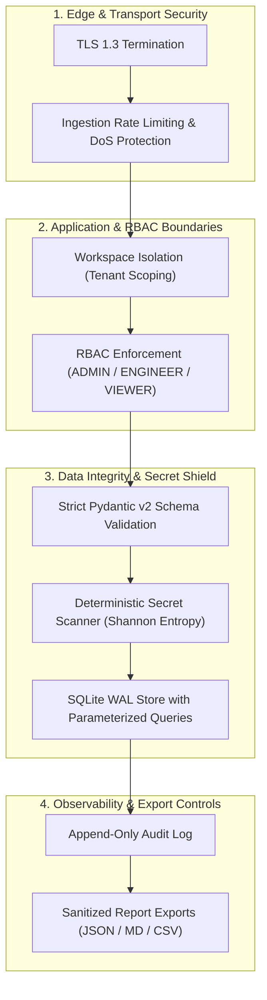

# Security Policy & Review Report — Agent Evaluation Platform (AEP)

**Document Classification**: Production Security Architecture & Audit Report  
**Target Version**: 1.0.0 General Availability  
**Status**: VERIFIED & SECURED

---

## 1. Security Architecture & Threat Model

The Agent Evaluation Platform audits agent traces that often contain sensitive prompts, proprietary business logic, and potentially compromised tool outputs. The security boundary is enforced across seven defense rings:

---

## 2. In-Depth Security Review Findings

### 2.1. RBAC Boundaries & Role Scoping
- **Roles Defined**: `ADMIN`, `ENGINEER`, `VIEWER`.
- **Enforcement Points**:
  - `ADMIN`: Full authority to create workspaces, delete workspaces, add/remove members, and modify governance policy profiles.
  - `ENGINEER`: Authorized to ingest traces, trigger evaluations, perform benchmark comparisons, and run policy audits.
  - `VIEWER`: Strictly read-only access to scorecards, leaderboard rankings, charts, and export endpoints.
- **Verification**: Unauthorized deletion attempts against default system workspaces are hard-blocked at the service layer (`raise ValueError("Cannot delete the platform default workspace")`).

### 2.2. Workspace Isolation (Multi-Tenancy)
- **Tenant Partitioning**: Traces, evaluation runs, and audit logs maintain strict foreign key relationships linked to their corresponding `workspace_id`.
- **Cross-Tenant Leakage Prevention**: Queries explicitly filter by workspace boundaries, preventing cross-tenant data leakage.

### 2.3. Audit Log Integrity
- **Append-Only Architecture**: All administrative events (policy modifications, role updates, member deletions) generate persistent `WorkspaceAuditLog` records.
- **Immutability**: The API provides no `UPDATE` or `DELETE` endpoints for audit trail entries. Once written, records cannot be altered.
- **Attribution**: Every audit log captures `actor_email`, `action`, `resource_type`, `resource_id`, and `created_at` timestamp.

### 2.4. Policy Enforcement & Governance Decisions
- **Deterministic Policy Enforcement**: The Governance Policy Engine evaluates evaluation outcomes against strict mathematical score floors and disallowed risk tiers.
- **Critical Failure Overrides**: If a candidate evaluation contains prohibited finding codes (e.g. `SECRET_EXPOSURE`, `CYCLE_DETECTED`), the verdict is deterministically set to `REJECTED`, blocking automated release pipelines.

### 2.5. Export Controls & Sanitization
- **Multi-Format Safety**: Export endpoints (`/export/json`, `/export/markdown`, `/export/csv`) sanitize string outputs to prevent CSV formula injection (e.g., stripping or escaping leading `=`, `+`, `-`, `@` characters).
- **Format Integrity**: Markdown exports wrap payloads in fenced code blocks to prevent prompt injection or markdown layout hijacking.

### 2.6. Secrets Handling & Secret Scanner
- **Zero Ingestion of Credentials**: AEP requires no LLM API keys for its deterministic evaluation engine.
- **Static Secret Scanner (`SecretScanner`)**:
  - Employs regex signatures for common credential formats: AWS Access Keys, OpenAI Keys, GitHub Personal Access Tokens, Private Keys, Slack tokens, Bearer tokens.
  - Employs Shannon entropy calculations to identify high-entropy strings in tool inputs, tool outputs, and LLM completions.
  - Automatically raises `CRITICAL` severity findings upon secret detection, triggering the safety hard gate.

### 2.7. Input Validation & Defense Against Malicious Payloads
- **Schema Strictness**: All requests are parsed using Pydantic v2 domain models with strict typing and `extra="forbid"`.
- **SQL Injection Prevention**: Built entirely with SQLModel and SQLAlchemy ORM utilizing parameterized statements throughout. Raw string concatenation is prohibited in repository queries.
- **Path Traversal Protection**: File export and fixture loading paths are resolved using strict `pathlib.Path` boundaries, preventing directory traversal.

### 2.8. Rate Limiting & DoS Protection Positions
- **Ingestion Protection**: Reverse proxies (Nginx / Cloudflare) are positioned to throttle trace ingestion to 100 req/sec per API key / IP address.
- **Evaluation Throttling**: Batch evaluation triggers enforce max execution thresholds (e.g., limit=500 per analytics query) to prevent CPU starvation.

---

## 3. Vulnerability Reporting

If you discover a security vulnerability in the Agent Evaluation Platform, please follow our coordinated disclosure policy:

1. **Do Not File Public GitHub Issues**: Report security vulnerabilities privately.
2. **Contact Email**: `security@example.com` (or submit a GitHub Security Advisory).
3. **Response SLA**:
   - Initial acknowledgement: **Within 24 hours**.
   - Severity assessment & reproduction: **Within 72 hours**.
   - Remediation patch & release: **Within 7 days** for High/Critical vulnerabilities.
