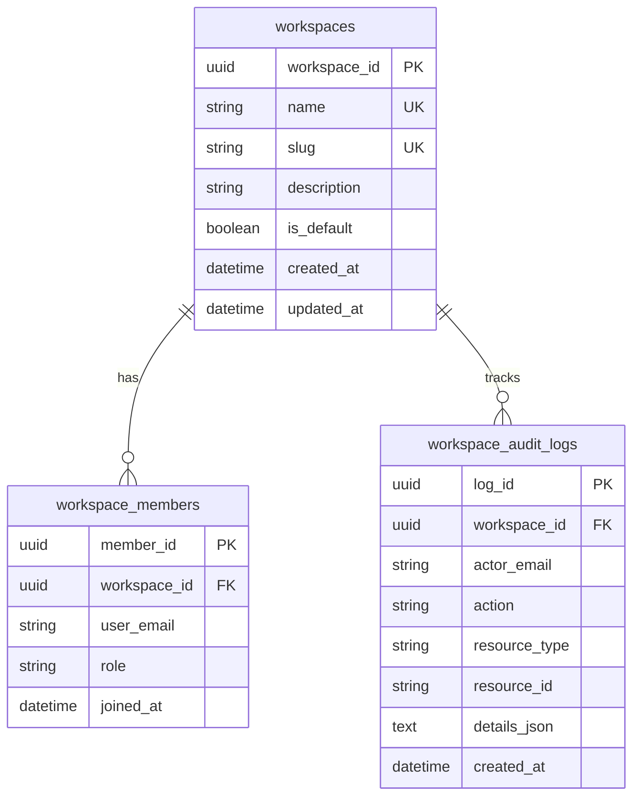

# Team & Organization Multi-Tenant Workspaces Engine

## 1. Overview & Objectives

The **Team & Organization Multi-Tenant Workspaces Engine** establishes logical workspace boundaries, multi-tenant team management, Role-Based Access Control (RBAC), and immutable governance audit trails across the Agent Evaluation Platform.

Key capabilities include:
- **Workspace Isolation**: Partition agent evaluation traces, benchmarks, and governance policies into distinct organizational workspaces (e.g. `Default Workspace`, `FinOps Swarm Workspace`, `Customer Support Swarm`).
- **Platform Default Workspace Bootstrapping**: Self-bootstraps a default workspace (`Default Workspace`, slug `default`) on initial query with an initial administrative member (`admin@example.com`).
- **Role-Based Access Control (RBAC)**: Enforces three distinct permission tiers:
  - `ADMIN`: Full authority over workspace configuration, policy management, member registration, and deletion.
  - `ENGINEER`: Permission to upload traces, trigger evaluation runs, execute benchmark comparisons, and perform governance audits.
  - `VIEWER`: Read-only access to evaluation summaries, graph DAG visualizations, analytics trends, and scorecard reports.
- **Immutable Governance Audit Trails**: Automatically logs auditable events (`WORKSPACE_INITIALIZED`, `WORKSPACE_CREATED`, `MEMBER_ADDED`, `MEMBER_ROLE_UPDATED`, `MEMBER_REMOVED`, `WORKSPACE_UPDATED`) recording actor identity, timestamp, action, and resource references.
- **Interactive Workspace Console**: Next.js 14 interface at `/workspaces` for workspace creation, switching, team member management, and audit timeline inspection.

---

## 2. RBAC Permission Hierarchy

```
       ┌────────────────────────┐
       │         ADMIN          │  Full configuration, membership,
       └───────────┬────────────┘  policies, and deletion rights
                   │
                   ▼
       ┌────────────────────────┐
       │        ENGINEER        │  Trace ingestion, evaluation execution,
       └───────────┬────────────┘  benchmarking, and policy audits
                   │
                   ▼
       ┌────────────────────────┐
       │         VIEWER         │  Read-only inspection of traces, scorecards,
       └────────────────────────┘  visualizations, and analytics
```

| Operation | ADMIN | ENGINEER | VIEWER |
| :--- | :---: | :---: | :---: |
| View Workspaces, Members & Audit Logs | ✓ | ✓ | ✓ |
| View Traces, Scorecards & Graph DAGs | ✓ | ✓ | ✓ |
| View Historical Analytics & Benchmarks | ✓ | ✓ | ✓ |
| Upload Canonical Traces (`POST /traces`) | ✓ | ✓ | ✗ |
| Execute Evaluations (`POST /evaluations/run`) | ✓ | ✓ | ✗ |
| Execute Regression Audits & Benchmarks | ✓ | ✓ | ✗ |
| Manage Policies (`POST/PUT/DELETE /policies`) | ✓ | ✗ | ✗ |
| Manage Members & Roles (`POST/DELETE /members`) | ✓ | ✗ | ✗ |
| Delete Workspaces (`DELETE /workspaces/{id}`) | ✓ | ✗ | ✗ |

---

## 3. Database Schema & Entities



---

## 4. API Specifications

### 4.1 `GET /api/v1/workspaces`
Lists all workspaces with member counts.

### 4.2 `GET /api/v1/workspaces/default`
Retrieves or auto-bootstraps the platform default workspace.

### 4.3 `POST /api/v1/workspaces`
Creates a new workspace, auto-generating an URL-safe slug if omitted, and assigns the creator as `ADMIN`.

```json
{
  "name": "FinOps Swarm Workspace",
  "slug": "finops-swarm",
  "description": "Financial and token budget tracking for autonomous agent workflows",
  "is_default": false
}
```

### 4.4 `GET /api/v1/workspaces/{workspace_id}`
Retrieves a specific workspace by UUID.

### 4.5 `PUT /api/v1/workspaces/{workspace_id}`
Updates workspace name, description, or default status.

### 4.6 `DELETE /api/v1/workspaces/{workspace_id}`
Deletes a custom workspace and cascades deletion of all its members and audit log records. Refuses deletion of the default platform workspace with HTTP 400.

### 4.7 `GET /api/v1/workspaces/{workspace_id}/members`
Lists all members in the workspace with their RBAC roles and join dates.

### 4.8 `POST /api/v1/workspaces/{workspace_id}/members`
Adds a team member or updates their assigned role.

```json
{
  "user_email": "engineer@example.com",
  "role": "ENGINEER"
}
```

### 4.9 `DELETE /api/v1/workspaces/{workspace_id}/members/{member_id}`
Removes a member from the workspace.

### 4.10 `GET /api/v1/workspaces/{workspace_id}/audit-logs`
Retrieves chronological audit trail events for the workspace.

---

## 5. Verification & Testing

- **Backend Unit Tests** (`backend/tests/services/test_workspace_service.py`):
  - Validates auto-seeding of default workspace and default admin member.
  - Validates custom workspace creation, listing, and slug generation.
  - Validates metadata updates and default workspace protection against deletion.
  - Validates member addition, role elevation/demotion, and member removal.
  - Validates automatic audit trail emission on all workspace actions.
- **Backend Integration Tests** (`backend/tests/api/test_workspace_endpoints.py`):
  - Validates full REST lifecycle across all 10 workspace endpoints.
  - Validates 404 responses for nonexistent workspace identifiers.
- **Frontend Vitest Suite** (`frontend/src/__tests__/workspaces.test.tsx`):
  - Tests rendering of workspace list, active workspace selection, member roster, role badges, and audit log entries.
  - Tests creation modal workflow and submission.
  - Tests member registration form interaction.

